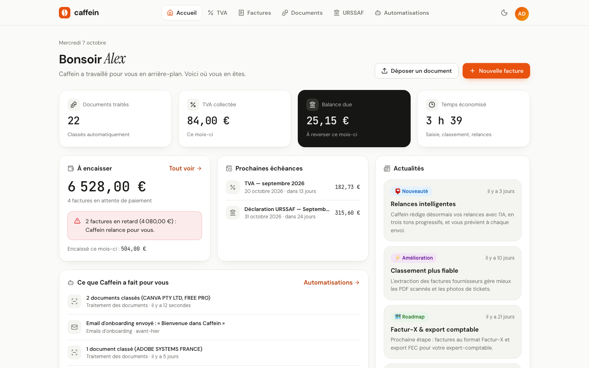
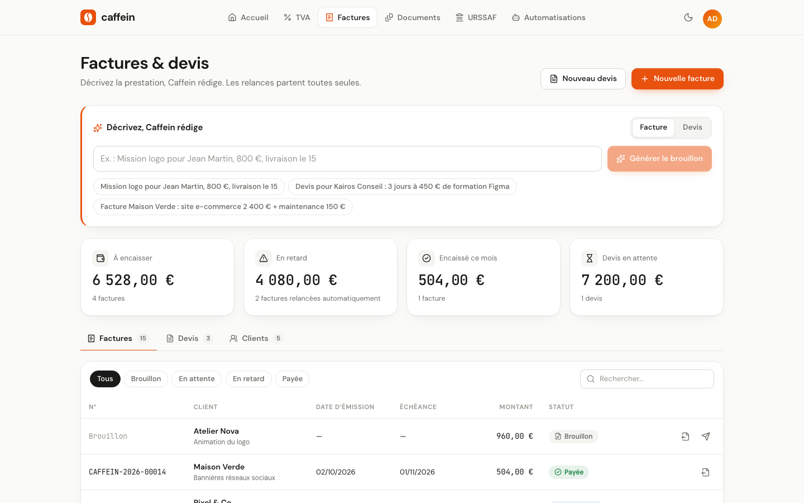
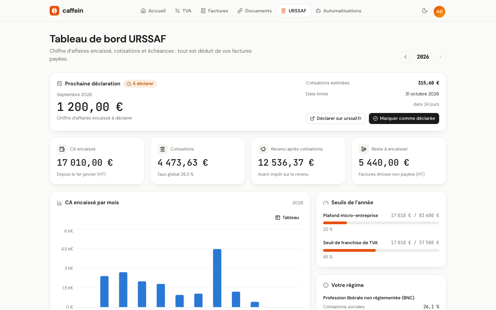
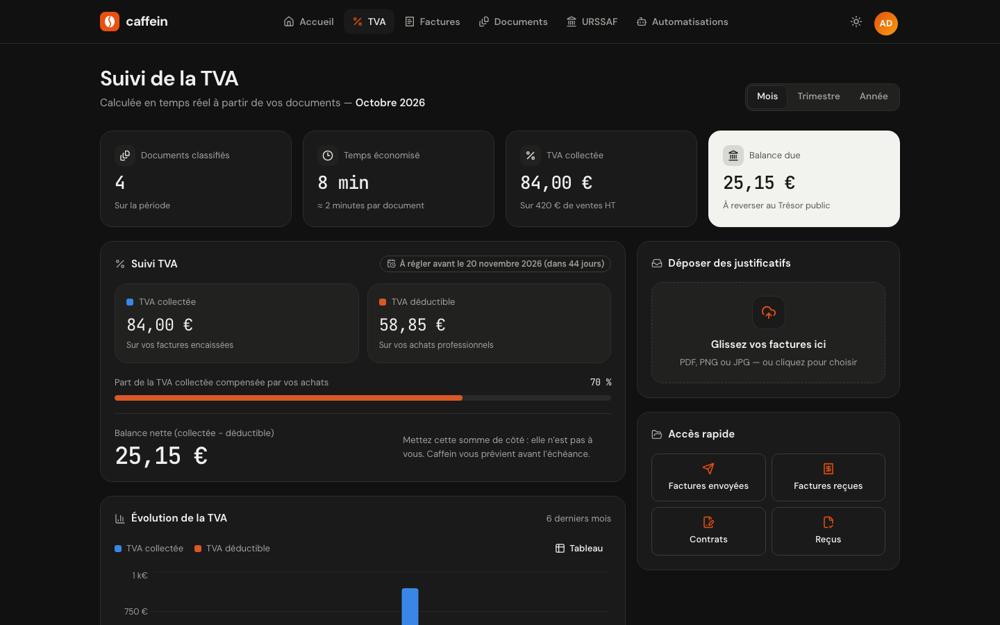
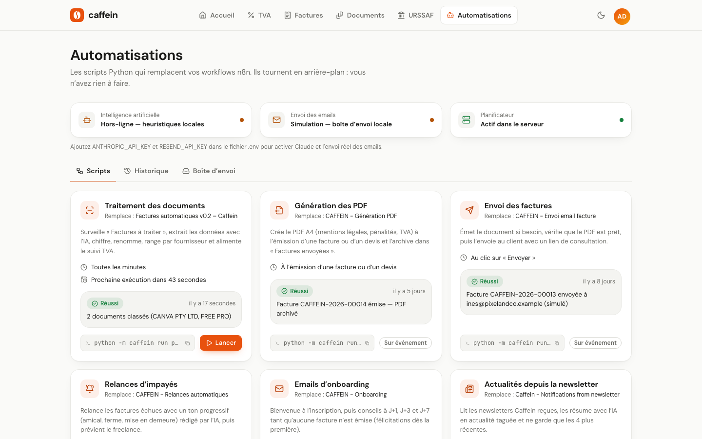
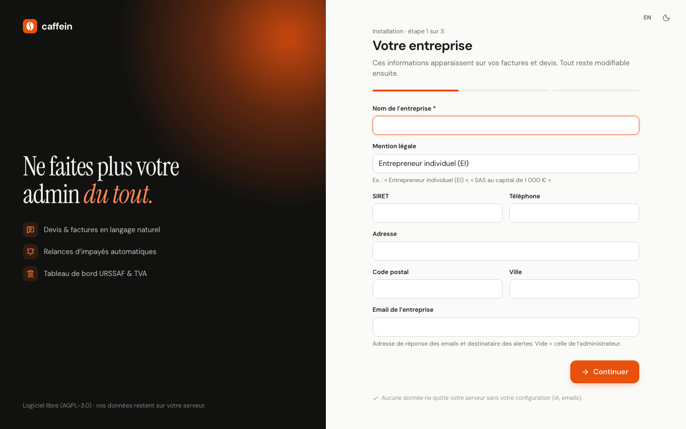

<div align="center">

# Caffein

**L'admin en pilote automatique pour les freelances, micro-entrepreneurs et TPE.**

Devis et factures en langage naturel · relances d'impayés automatiques · suivi de la TVA · tableau de bord URSSAF.
Logiciel libre, auto-hébergé sur votre serveur Linux ou dans un conteneur.

[](LICENSE)




</div>

## Fonctionnalités

- **Factures et devis en une phrase.** « Mission logo pour Jean Martin, 800 €, livraison le 15 » suffit pour créer un brouillon
  (client, lignes, dates). PDF A4 avec les mentions légales (EI, SIRET, TVA ou art. 293 B, pénalités de retard, SIREN du client),
  numérotation continue, transformation devis → facture, envoi par email et page de consultation pour le client avec l'IBAN.
- **Relances d'impayés.** Trois niveaux (rappel amical, relance ferme, mise en demeure amiable) rédigés par l'IA ou par des modèles,
  une fois par semaine au plus, avec une notification à chaque envoi.
- **Justificatifs classés tout seuls.** Déposez une facture fournisseur (PDF ou photo) : fournisseur, montants, catégorie et échéance
  sont extraits, chiffrés en AES-256-GCM, puis le fichier est renommé et rangé par fournisseur.
- **TVA.** TVA collectée (à l'encaissement), TVA déductible, balance à reverser, échéance et évolution sur l'année.
- **URSSAF.** Chiffre d'affaires encaissé, cotisations selon votre activité, déclarations mensuelles ou trimestrielles,
  suivi du plafond micro-entreprise et du seuil de franchise de TVA.
- **Automatisations.** Huit scripts Python planifiés (classement, PDF, envois, relances, alertes…), avec leur historique
  et une boîte d'envoi pour relire chaque email.
- **Multi-utilisateurs.** Rôles administrateur et membre, assistant d'installation, interface FR/EN, thème clair ou sombre.
- **Local par défaut.** Sans clé ni serveur mail, tout fonctionne : l'IA passe en analyse locale et les emails restent
  dans la boîte d'envoi. Aucune donnée ne quitte votre serveur tant que vous ne branchez pas Claude ou un SMTP.

| | |
|---|---|
|  |  |
|  |  |

## Installation

Trois façons d'installer Caffein. Dans tous les cas, ouvrez ensuite l'adresse de l'instance :
**l'assistant d'installation** crée votre entreprise et le compte administrateur.



### Avec Docker (recommandé)

```bash
git clone https://github.com/moreauremi/caffein.git
cd caffein
cp .env.example .env        # facultatif : clé IA, SMTP, adresse publique…
docker compose up -d
```

L'instance répond sur **http://localhost:8000**. Les données vivent dans le volume Docker `caffein-data`.

```bash
docker compose logs -f                        # journaux
docker compose exec caffein caffein backup    # sauvegarde
git pull && docker compose up -d --build      # mise à jour
```

Une fois une version publiée (tag `v*`), l'image est aussi disponible sur `ghcr.io/moreauremi/caffein`.

### Sur un serveur Linux (systemd)

Debian, Ubuntu, Fedora, RHEL/Rocky/Alma, Arch ou openSUSE, avec Python ≥ 3.10. Node.js ≥ 18 n'est nécessaire que si vous
installez depuis le dépôt git : les archives de version contiennent l'interface déjà construite.

```bash
git clone https://github.com/moreauremi/caffein.git
cd caffein
sudo ./install.sh --url https://caffein.mondomaine.fr
```

| Emplacement | Contenu |
|---|---|
| `/opt/caffein` | code et environnement Python (remplacés à chaque mise à jour) |
| `/etc/caffein/caffein.env` | configuration (conservée) |
| `/var/lib/caffein` | base SQLite, documents, clé de chiffrement, sauvegardes (conservés) |
| `/usr/local/bin/caffein` | commande d'administration |

- **Mise à jour** : `git pull && sudo ./install.sh`. Une sauvegarde est faite avant, puis les migrations sont appliquées.
- **Désinstallation** : `sudo ./deploy/uninstall.sh`. Ajoutez `--purge` pour supprimer aussi la configuration et les données.

Options du script : `--host`, `--port`, `--url`, `--demo`, `--no-start`, `--yes` (voir `./install.sh --help`).

### En local, pour essayer ou développer

```bash
./start.sh          # http://localhost:8000
./start.sh --demo   # instance de démonstration avec le bouton « Accès démo »
./dev.sh            # rechargement à chaud : API sur :8000, interface Vite sur :5173
```

## Configuration

Toute la configuration passe par des variables d'environnement. Le modèle commenté est [`.env.example`](.env.example).

| Variable | Rôle |
|---|---|
| `CAFFEIN_APP_URL` | Adresse publique (liens des emails). En `https://`, les cookies passent en mode sécurisé. |
| `CAFFEIN_HOST`, `CAFFEIN_PORT` | Interface et port d'écoute (`127.0.0.1:8000` par défaut, `0.0.0.0` dans Docker). |
| `CAFFEIN_SMTP_*`, `CAFFEIN_EMAIL_FROM` | Envoi réel des emails par SMTP. `RESEND_API_KEY` est une alternative. |
| `ANTHROPIC_API_KEY`, `CAFFEIN_AI_MODEL` | Active Claude pour la lecture des factures, les devis en langage naturel et les relances. |
| `CAFFEIN_DEMO` | Mode démonstration : données d'exemple et accès sans mot de passe. |
| `CAFFEIN_SOURCE_URL` | Lien vers le code source de votre version, affiché dans « À propos ». Par défaut : ce dépôt. À changer si vous publiez une version modifiée (voir [Licence](#licence)). |
| `CAFFEIN_FORWARDED_ALLOW_IPS` | IP du reverse proxy, s'il ne tourne pas sur la même machine. |
| `CAFFEIN_IMAP_*` | Lecture d'une boîte mail pour publier des newsletters en actualités. |

Après une modification : `docker compose up -d` ou `sudo systemctl restart caffein`.

## Exploitation

**HTTPS.** Placez Caffein derrière un reverse proxy. Des exemples prêts à l'emploi sont fournis :
[nginx](deploy/nginx.conf) et [Caddy](deploy/Caddyfile). Renseignez ensuite `CAFFEIN_APP_URL=https://…`.

**Sauvegardes.** `caffein backup` crée une archive avec la base (copie cohérente, même service démarré), les documents,
la boîte d'envoi et la clé de chiffrement. Sans cette clé, les montants chiffrés sont illisibles. Copiez donc les archives hors du serveur.

```bash
sudo caffein backup                                   # → /var/lib/caffein/backups/
sudo systemctl stop caffein
sudo caffein restore /chemin/caffein-backup.tar.gz --force
sudo systemctl start caffein
```

Pour une sauvegarde quotidienne : `0 2 * * * /usr/local/bin/caffein backup` dans la crontab root.

**Commandes d'administration** (préfixe `sudo caffein`, ou `docker compose exec caffein caffein`) :

| Commande | Effet |
|---|---|
| `create-admin --email E` | crée un administrateur (mot de passe demandé) |
| `reset-password --email E` | change un mot de passe et ferme les sessions ouvertes |
| `users` | liste les comptes |
| `backup` / `restore` | sauvegarde et restauration |
| `migrate` | applique les migrations de la base |
| `jobs` / `run <script>` | liste ou lance un script d'automatisation |
| `seed --demo` | charge les données de démonstration |
| `health` | vérifie que le serveur répond |

**Journaux** : `journalctl -u caffein -f` ou `docker compose logs -f`.

## Architecture

API **FastAPI** et base **SQLite**, interface **React** (Vite, React Router, Recharts) servie par le même processus, et un
planificateur intégré qui lance les scripts d'automatisation. Pas de service externe obligatoire. Le détail (modèle de données,
sécurité, scripts, migrations) est dans [docs/architecture.md](docs/architecture.md).

```
backend/caffein/   api/ · jobs/ (scripts) · services.py · ai.py · auth.py · db.py (migrations) · pdf_invoice.py …
frontend/src/      pages/ · components/ · context/ · lib/i18n.js (FR/EN)
deploy/            service systemd, reverse proxy, désinstallation
```

## Contribuer

Les contributions sont bienvenues : tickets, corrections, traductions, nouvelles fonctionnalités.
Lisez [CONTRIBUTING.md](CONTRIBUTING.md) avant d'ouvrir une pull request. Pour une faille de sécurité, suivez [SECURITY.md](SECURITY.md).

## Licence

Caffein est distribué sous licence **GNU Affero General Public License v3.0 ou ultérieure** ([LICENSE](LICENSE)).
Vous pouvez l'utiliser, l'étudier, le modifier et le redistribuer librement.
Si vous proposez une **version modifiée** à d'autres personnes **via le réseau** (par exemple un SaaS), vous devez leur donner
accès au code source de cette version : publiez vos modifications et pointez `CAFFEIN_SOURCE_URL` vers votre dépôt.

> Les taux de cotisations et les seuils fiscaux (`backend/caffein/fiscal.py`) sont des valeurs indicatives pour 2026.
> Caffein aide à préparer vos déclarations ; il ne remplace ni l'URSSAF, ni l'administration fiscale, ni un expert-comptable.
